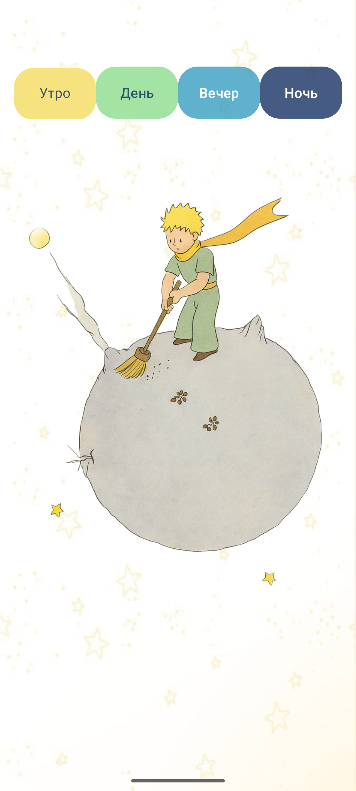
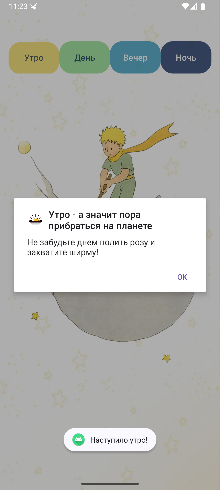
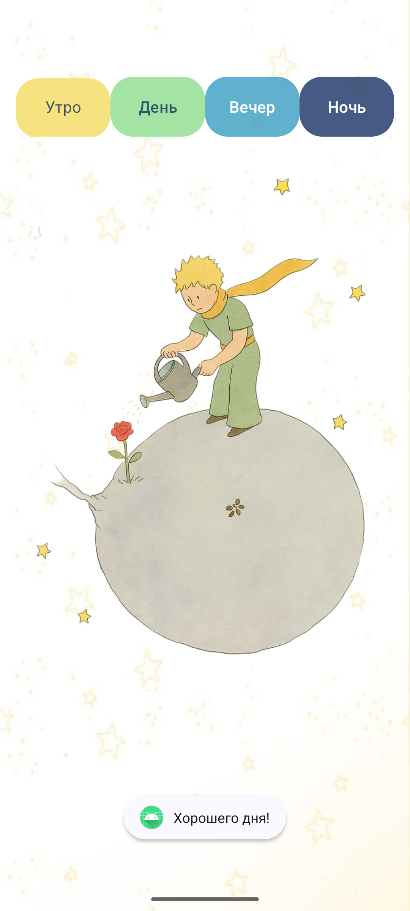
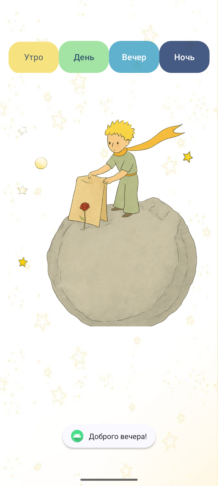
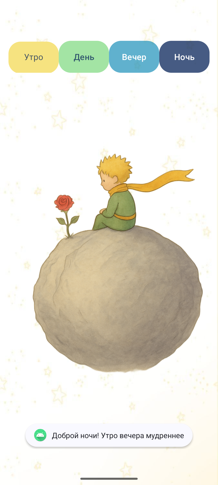

# Petite Prince App (Тамагочи)

Интерактивное приложение-тамагочи, посвященное «Маленькому принцу». Пользователь может менять время суток, а приложение реагирует на это сменой иллюстраций, звуковым сопровождением и текстовыми заданиями.

  
   
  
  
  
  
  

## Стек
- Язык: Java
- Платформа: Android
- Среда разработки: Android Studio
- Интерфейс: XML 
- Android SDK (Toast, MediaPlayer для звуков)

Ключевые элементы:
1. Четыре времени суток - утро, день, вечер, ночь
2. Визуальная смена - уникальные изображения для каждого периода 
3. Интерактивные уведомления - напоминания о действиях
4. Звуковое сопровождение смены суток
   - Утро: "Привести в порядок свою планету"
   - День: "Полить розу"
   - Вечер: "Закрыть розу ширмой"
   - Ночь: "Полюбоваться закатом"

    
## Что реализовано
- Интерфейс с кнопками выбора времени суток
- Динамическая смена изображения на экране в зависимости от выбранного времени
- Воспроизведение звуковых файлов при нажатии кнопок
- Вывод всплывающих уведомлений (Toast) с заданиями для пользователя
